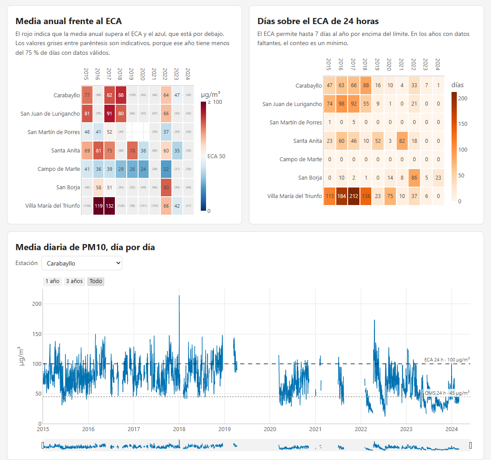

# Calidad del aire en Lima Metropolitana, 2015-2024

Dashboard interactivo con las concentraciones horarias de PM10, PM2.5 y NO2 de las siete estaciones automáticas del SENAMHI en Lima Metropolitana, comparadas con el Estándar de Calidad Ambiental para Aire (ECA, D.S. 003-2017-MINAM) y con las guías de calidad del aire de la OMS de 2021.

El dashboard está publicado en https://cristhianbgf.github.io/calidad-aire-lima/



## Resultados

Las cifras salen de [`salidas/resumen.json`](salidas/resumen.json). Un año-estación tiene datos suficientes cuando al menos el 75 % de sus días son válidos.

| Contaminante | Media anual sobre el ECA | Media anual sobre la guía de la OMS | ECA de corto plazo |
|---|---|---|---|
| PM10 | 20 de 34 años-estación (ECA de 50 µg/m³) | 34 de 34 (guía de 15 µg/m³) | 33 años-estación pasaron los 7 días al año permitidos sobre 100 µg/m³ |
| PM2.5 | 13 de 28 (25 µg/m³) | 28 de 28 (5 µg/m³) | 14 años-estación pasaron los 7 días permitidos sobre 50 µg/m³ |
| NO2 | 0 de 18 (100 µg/m³) | 18 de 18 (10 µg/m³) | 1 hora sobre 200 µg/m³ en todo el registro, con 24 al año permitidas |

Las medias anuales reportables más altas fueron la del PM10 en Villa María del Triunfo en 2017 (131.6 µg/m³), la del PM2.5 en San Juan de Lurigancho en 2022 (41.2 µg/m³) y la del NO2 en Santa Anita en 2022 (28.4 µg/m³).

Son estaciones de vigilancia del aire ambiente, así que la comparación describe el aire que se respira en cada distrito y no el cumplimiento de una fuente en particular. El ECA es la referencia legal en el Perú, mientras que las guías de la OMS son una referencia de salud y no son vinculantes.

## Datos

Los datos son del conjunto *Monitoreo de los contaminantes del aire en Lima Metropolitana* del SENAMHI, publicado en la [Plataforma Nacional de Datos Abiertos](https://www.datosabiertos.gob.pe/dataset/monitoreo-de-los-contaminantes-del-aire-en-lima-metropolitana-servicio-nacional-de) con licencia Open Data Commons Attribution. Son datos horarios validados del 1 de enero de 2015 al 31 de mayo de 2024. El repositorio incluye datos derivados de ese conjunto, que son las medias diarias y los resúmenes anuales.

El CSV original no está en el repositorio. Para reproducir el análisis hay que descargarlo de la página del conjunto y guardarlo como `data/crudo/senamhi_calidad_aire_lima.csv`. La versión que se usó pesa 68 501 558 bytes y su SHA-256 es `896ae8a106fb128460e81b3f58096f6b9c4d582ef28fffa46e5394c5875c40d4`.

## Método

[`src/preparar_datos.py`](src/preparar_datos.py) lee los valores con `pd.to_numeric(errors="coerce")` y pone cada estación sobre una grilla horaria completa, para que las horas sin registro cuenten como faltantes. No hubo fechas imposibles ni valores negativos. Hubo 42 horas-estación del 1 de mayo de 2024 repetidas con valores distintos, y se eliminaron todas sus copias.

Una media diaria exige al menos 18 horas válidas (75 %). Una media anual solo se reporta cuando al menos el 75 % de los días del año son válidos y, en otro caso, se muestra como indicativa. Las medias se comparan con los estándares antes de redondearlas.

[`src/cumplimiento.py`](src/cumplimiento.py) compara cada estación y año con el ECA publicado en El Peruano el 7 de junio de 2017 y con las guías de la OMS de 2021. El ECA fija para el PM10 100 µg/m³ en 24 horas, con hasta 7 excedencias al año, y 50 µg/m³ como media anual. Para el PM2.5 fija 50 µg/m³ en 24 horas, también con hasta 7 excedencias al año, y 25 µg/m³ como media anual. Para el NO2 fija 200 µg/m³ en 1 hora, con hasta 24 excedencias al año, y 100 µg/m³ como media anual. Las guías de la OMS son 45 y 15 µg/m³ para el PM10, 15 y 5 µg/m³ para el PM2.5, y 25 y 10 µg/m³ para el NO2, en 24 horas y como media anual.

[`src/construir_dashboard.py`](src/construir_dashboard.py) arma la página con Plotly. La página es estática y un script corto cambia el contaminante y la estación en el navegador.

## Verificación de unidades

El diccionario de datos no indica las unidades. Para confirmarlas, [`src/verificar_boletin.py`](src/verificar_boletin.py) compara las medias diarias con los máximos de PM10 del boletín del SENAMHI de febrero de 2018 para Lima.

| Estación | Boletín | Este repositorio |
|---|---|---|
| Carabayllo | 89.5 µg/m³ el día 24 | 97.3 µg/m³ el día 24 |
| San Martín de Porres | 95.4 µg/m³ el día 13 | 93.1 µg/m³ el día 13 |
| San Juan de Lurigancho | 106.1 µg/m³ el día 24, con 2 días sobre 100 | 105.9 µg/m³ el día 24, con 2 días sobre 100 |

Los días coinciden y los valores difieren en menos de 8 µg/m³, así que todos los valores se leen en µg/m³. El conjunto abierto es la serie validada, por lo que no tiene por qué coincidir con el boletín al decimal.

## Cómo reproducirlo

```bash
pip install -r requirements.txt
python src/preparar_datos.py
python src/cumplimiento.py
python src/verificar_boletin.py
python src/construir_dashboard.py
```

## Limitaciones

El NO2 es el contaminante con más vacíos, con 52 % de horas válidas, y en los años incompletos los conteos de excedencias son mínimos. El año 2024 cubre solo de enero a mayo, así que ninguna media anual de 2024 es reportable. El conjunto de datos no incluye meteorología, por lo que no se analiza el efecto del viento en cada estación.

## Licencia

El código está bajo la licencia MIT, que está en [LICENSE](LICENSE). Los datos derivados del SENAMHI conservan la licencia Open Data Commons Attribution.
