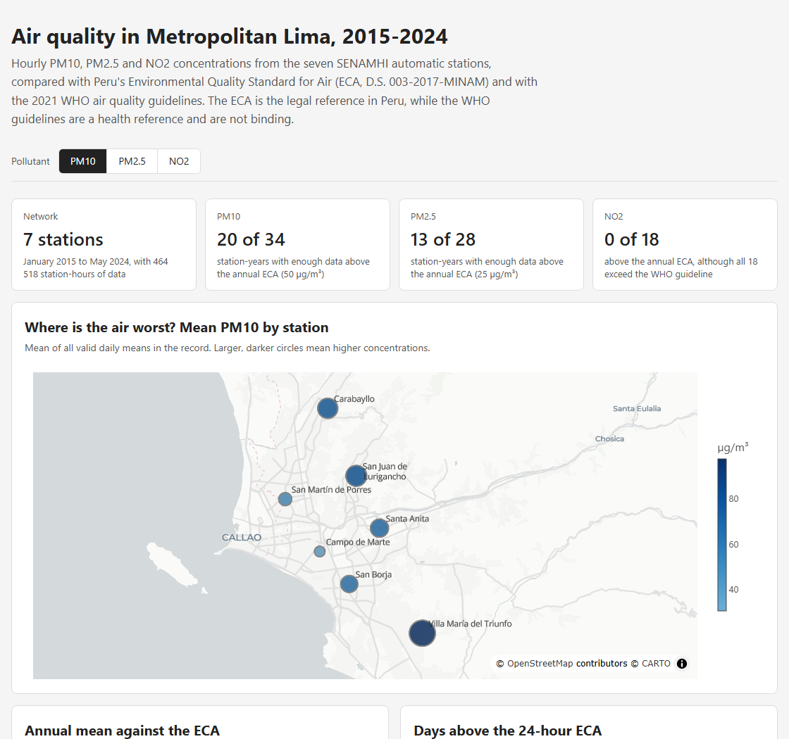

# Air quality in Metropolitan Lima, 2015-2024

Interactive dashboard of hourly PM10, PM2.5 and NO2 concentrations from the seven SENAMHI automatic stations in Metropolitan Lima, compared with Peru's Environmental Quality Standard for Air (ECA, D.S. 003-2017-MINAM) and with the 2021 WHO air quality guidelines.

The dashboard is published at https://cristhianbgf.github.io/calidad-aire-lima/



## Results

Figures come from [`salidas/resumen.json`](salidas/resumen.json). A station-year has enough data when at least 75 % of its days are valid.

| Pollutant | Annual mean above the ECA | Annual mean above the WHO guideline | Short-term ECA |
|---|---|---|---|
| PM10 | 20 of 34 station-years (ECA of 50 µg/m³) | 34 of 34 (guideline of 15 µg/m³) | 33 station-years exceeded the 7 days per year allowed above 100 µg/m³ |
| PM2.5 | 13 of 28 (25 µg/m³) | 28 of 28 (5 µg/m³) | 14 station-years exceeded the 7 days allowed above 50 µg/m³ |
| NO2 | 0 of 18 (100 µg/m³) | 18 of 18 (10 µg/m³) | 1 hour above 200 µg/m³ in the whole record, with 24 per year allowed |

The highest reportable annual means were PM10 in Villa María del Triunfo in 2017 (131.6 µg/m³), PM2.5 in San Juan de Lurigancho in 2022 (41.2 µg/m³) and NO2 in Santa Anita in 2022 (28.4 µg/m³).

These are ambient air monitoring stations, so the comparison describes the air breathed in each district and does not assess the compliance of any particular source. The ECA is the legal reference in Peru, while the WHO guidelines are a health reference and are not binding.

## Data

The data come from the dataset *Monitoreo de los contaminantes del aire en Lima Metropolitana* of SENAMHI (Peru's National Meteorology and Hydrology Service), published on Peru's [National Open Data Platform](https://www.datosabiertos.gob.pe/dataset/monitoreo-de-los-contaminantes-del-aire-en-lima-metropolitana-servicio-nacional-de) under the Open Data Commons Attribution licence. They are validated hourly data from 1 January 2015 to 31 May 2024. The repository includes data derived from that dataset: daily means and annual summaries.

The original CSV is not in the repository. To reproduce the analysis, download it from the dataset page and save it as `data/crudo/senamhi_calidad_aire_lima.csv`. The version used is 68 501 558 bytes and its SHA-256 is `896ae8a106fb128460e81b3f58096f6b9c4d582ef28fffa46e5394c5875c40d4`.

## Method

[`src/preparar_datos.py`](src/preparar_datos.py) reads values with `pd.to_numeric(errors="coerce")` and puts each station on a complete hourly grid, so hours without a record count as missing. There were no impossible dates or negative values. There were 42 station-hours on 1 May 2024 duplicated with different values, and all their copies were removed.

A daily mean requires at least 18 valid hours (75 %). An annual mean is only reported when at least 75 % of the days of the year are valid; otherwise it is shown as indicative. Means are compared with the standards before rounding.

[`src/cumplimiento.py`](src/cumplimiento.py) compares each station and year with the ECA published in El Peruano on 7 June 2017 and with the 2021 WHO guidelines. The ECA sets 100 µg/m³ over 24 hours for PM10, with up to 7 exceedances per year, and 50 µg/m³ as the annual mean. For PM2.5 it sets 50 µg/m³ over 24 hours, also with up to 7 exceedances per year, and 25 µg/m³ as the annual mean. For NO2 it sets 200 µg/m³ over 1 hour, with up to 24 exceedances per year, and 100 µg/m³ as the annual mean. The WHO guidelines are 45 and 15 µg/m³ for PM10, 15 and 5 µg/m³ for PM2.5, and 25 and 10 µg/m³ for NO2, over 24 hours and as the annual mean.

[`src/construir_dashboard.py`](src/construir_dashboard.py) builds the page with Plotly. The page is static, and a short script switches pollutant and station in the browser.

## Unit check

The data dictionary does not state the units. To confirm them, [`src/verificar_boletin.py`](src/verificar_boletin.py) compares the daily means with the PM10 maxima in SENAMHI's February 2018 bulletin for Lima.

| Station | Bulletin | This repository |
|---|---|---|
| Carabayllo | 89.5 µg/m³ on day 24 | 97.3 µg/m³ on day 24 |
| San Martín de Porres | 95.4 µg/m³ on day 13 | 93.1 µg/m³ on day 13 |
| San Juan de Lurigancho | 106.1 µg/m³ on day 24, with 2 days above 100 | 105.9 µg/m³ on day 24, with 2 days above 100 |

The days match and the values differ by less than 8 µg/m³, so all values are read in µg/m³. The open dataset is the validated series, so it need not match the bulletin to the decimal.

## How to reproduce

```bash
pip install -r requirements.txt
python src/preparar_datos.py
python src/cumplimiento.py
python src/verificar_boletin.py
python src/construir_dashboard.py
```

## Limitations

NO2 is the pollutant with the most gaps, with 52 % valid hours, and in incomplete years exceedance counts are minimums. 2024 only covers January to May, so no 2024 annual mean is reportable. The dataset does not include meteorology, so the effect of wind at each station is not analysed.

## Licence

The code is under the MIT licence, in [LICENSE](LICENSE). Data derived from SENAMHI keep the Open Data Commons Attribution licence.
